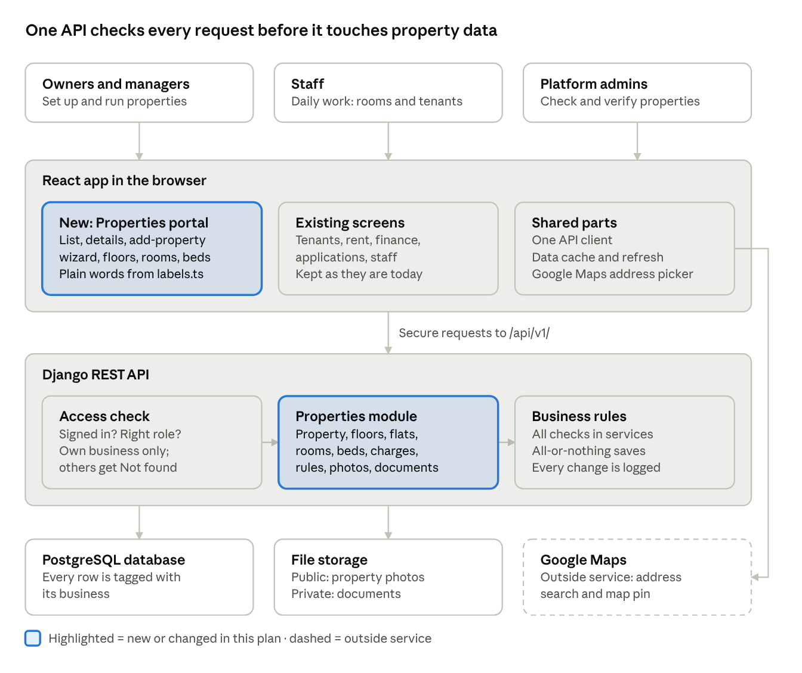
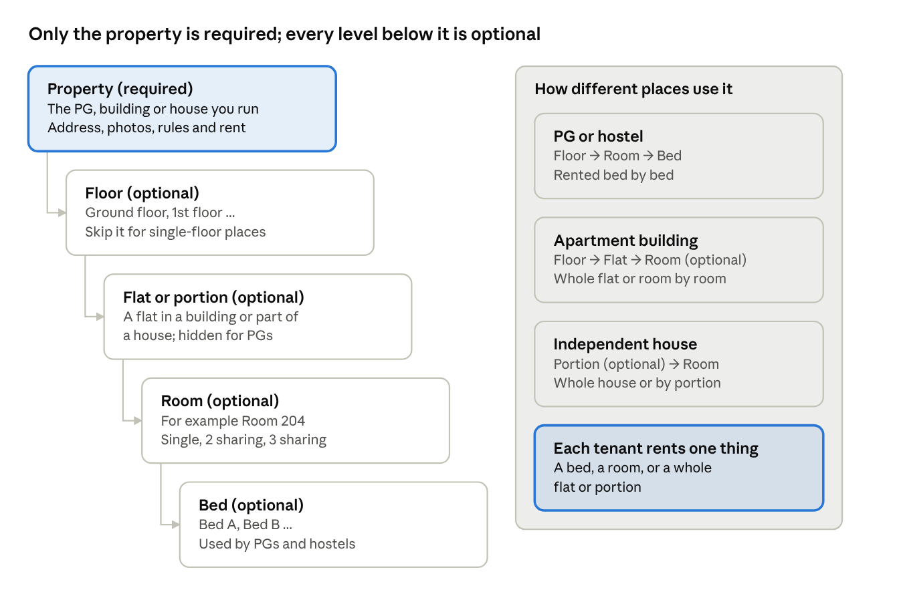

# Properties Management Portal: Architecture & Plan

> Exported on 18 Oct 2026 from the living Claude Doc: https://claude.ai/code/artifact/7636ace6-3811-4145-9d06-609cd5d2c695
> The online doc is the source of truth; re-export after changes.

Oct 18, 2026 · @Hasaai

## Summary

The portal extends the existing app rather than replacing it. The current model is **Property → Room → Bed** with rent and tenancies on beds. It becomes **Property → optional Floor → optional Unit → optional Room → optional Bed**. Price, status, amenities and tenancies sit on whichever level is actually rented.

**Priority (agreed with San, 18 Oct 2026):** build the SaaS platform first, so operators can run all their daily operations in it: properties, rooms and beds, tenants, rent, expenses, staff and reports. The public marketplace apps (search, listings, booking, SEO) come later as a separate stage. Until then, marketplace code is only kept working and is not extended.

No code changes until you approve this plan. Five decisions are needed first (last section):

1. UI stack: adopt Tailwind + shadcn/ui + React Hook Form + Zod, as the brief asks, or keep the current plain-CSS design system.
2. Whether a room may sit directly under a property (recommended) or must always belong to a unit.
3. Whether tenancies can start on a whole unit or room in this project (needed for family rentals), or only after it.
4. Who the "SaaS administrators" are: Django staff accounts that verify properties and edit the amenity catalog.
5. Pagination for admin tables: numbered pages with totals, replacing the current cursor paging for these screens.

Estimated size: seven phases, each delivered and tested separately, roughly the size of the last three rounds combined. The public marketplace is untouched apart from keeping it working.

## Architecture at a glance

The browser talks to one API only. Before that API reads or changes any property data, it checks who you are, your role and which business you belong to.

Only the property itself is required. Floors, flats or portions, rooms and beds are added only where a place actually has them.

## Where the code is today

Properties, rooms, beds, amenities, photos and organization isolation exist; the biggest gaps are units, floors, independent statuses and the UI stack.

| Area | Today (commit d4aee6d) | Gap against the brief |
| --- | --- | --- |
| Hierarchy | `Property` → `Room` → `Bed`. Creating a room always creates its beds. Rent lives on `Bed.monthly_rent`. | No floors (`Room.floor` is free text), no rental units, no way to rent a whole room, flat or house. |
| Property type | `property_type`: PG, co-living, hostel, apartment, independent house, standalone building. `gender` = who it is for. | No rental model, target tenant type or inventory structure fields. |
| Status | `Property.is_active` (yes/no). Verification is on the marketplace `Listing` (`is_verified`). | No draft, archived or verification states on the property; no verification history. |
| Tenancies | `Stay` is always on one bed; check-in, notice, transfer, checkout work. | A family renting a flat would need fake bed records. |
| Amenities | Catalog of 14 categories (69 amenities) in the database; property-level or selected-room assignments with sharing, charges and details. | No unit or bed scope; catalog editable only in Django admin. |
| Pricing | Per-bed rent; deposit agreed per stay. | No billing frequency, maintenance charge or extra fees configuration. |
| Policies | `Listing.house_rules` (text); notice and lock-in per stay. | No structured visitor, pet, cooking or stay-duration policies. |
| Media | Property photos (public) and stay agreements (private, streamed only to owner/manager). | No property documents (ownership proof), floor plans or unit/room photos. |
| API | DRF under `/api/v1/`, org-scoped base classes, cursor pagination, audit log. | No numbered pages or totals, sorting, bulk actions, global search. |
| UI | React 19 + Vite + TanStack Query, plain CSS, own form helper, 18 operator screens. | Brief requires Tailwind, shadcn/ui, Lucide, React Hook Form, Zod, Recharts — none installed. |
| Tests | 316 backend tests (SQLite and PostgreSQL), 83 frontend unit tests, one browser journey. | New scenarios: flats, family rental, house, cross-tenant inventory, document access. |

What stays as is: authentication (JWT + refresh cookie), organization isolation, roles (owner, manager, staff), audit log, billing, tenants, finance, reminders, applications.

## Target domain model

Every level below Property is optional, and each Unit or Room says whether it is let **whole** or **by its parts**. That one setting decides where rent, availability and tenancies live, so no artificial records are needed.

| Model | New or existing | Key fields | Rules enforced in the database or services |
| --- | --- | --- | --- |
| Property | Existing, extended | type, rental model, target tenants, inventory structure, operational status, verification status, address incl. state, building name, floor count, area + unit, year built, utilities | Name unique per organization; status changes go through services with audit entries |
| Floor | New, optional | property, number (−2 to 200), name ("Ground", "Terrace") | Number unique per property |
| RentalUnit | New, optional | property, floor?, code ("Flat 302"), unit type (1RK, 1BHK, 2BHK, 3BHK, studio, whole house), bedrooms, bathrooms, area, furnishing, letting (whole / by rooms), rent?, deposit?, capacity, status | Code unique per property; rent required when let whole |
| Room | Existing, extended | property, unit?, floor? (replaces free-text floor), number, room type (private / shared / dormitory), letting (whole / by beds), rent?, status | Unit must belong to the same property; number unique per unit, or per property when there is no unit |
| Bed | Existing | room, label, rent, status | Only lettable when its room is let by beds |
| Stay (tenancy) | Existing, extended | exactly one of bed, room or unit | One active stay per bed, room or unit; no stay on a part of something already let whole |
| PropertyCharge | New | property, optional unit/room/bed, kind (maintenance, electricity, food, parking, cleaning, move-in, agreement fee), amount, frequency (monthly, quarterly, yearly, one-time), refundable | Amount > 0; the target belongs to the property |
| PropertyPolicy | New, one per property | billing frequency, deposit rule, house rules, visitors, pets, cooking, smoking/alcohol, gate time, minimum stay, notice period, lock-in | Defaults copied into each new stay, which can override them |
| PropertyImage | Existing photo model, extended | kind (exterior, common area, unit, room, floor plan), optional unit/room, caption, order | Up to 50 per property; images are public files |
| PropertyDocument | New | kind (ownership proof, management authorization, tax receipt, NOC, other), private file, expiry? | Private storage; downloaded only by the property's owners and managers |
| VerificationEvent | New | status (submitted, approved, rejected, changes requested), note, actor, time | Append-only history; the property keeps the current status |
| Amenity assignment | Existing, extended | scope: property, unit, room or bed, plus the chosen units/rooms/beds | Catalog says which scopes an amenity allows; targets belong to the property |

The amenity catalog and its categories stay global. Everything else is organization-scoped and returns "not found" across organizations, as today.

## How each property type is represented

One set of models covers every type; only the records an owner actually needs are created. The type sets sensible defaults, and the service rejects combinations that cannot work.

| Example | Records created | Rented at | Rent stored on |
| --- | --- | --- | --- |
| PG, 3 floors, 12 rooms, 30 beds | Property → 3 Floors → 12 Rooms (let by beds) → 30 Beds | Bed | Each bed |
| Co-living with private and shared rooms | Property → Rooms: private ones let whole, shared ones let by beds → Beds only in shared rooms | Room or bed (mixed) | Private room; beds in shared rooms |
| Co-living flat (3BHK let by room) | Property → Unit "A-101" (let by rooms) → 3 Rooms (let whole) | Room | Each room |
| Hostel dormitory | Property → Rooms (type dormitory, let by beds) → Beds | Bed | Each bed |
| Standalone building, 8 flats | Property → Floors → 8 Units (let whole) | Unit | Each unit |
| Apartment rented to a family | Property (type apartment) → 1 Unit (let whole) | Unit | The unit |
| Independent house / villa | Property (type house) → 1 Unit "Whole house" (let whole), created automatically | Unit | The unit |

Validation examples: a unit let whole cannot have bed-level rent; a room let by beds needs at least one bed before it can be activated; a bed cannot get a tenancy while its room or unit is let whole to someone. Defaults per type, for example PG → let by beds and house → one whole unit, are suggestions the owner can change.

## Statuses and lifecycle

Three statuses move independently: whether the property is operating, whether the platform has verified it, and whether it is published on the marketplace. Today these are mixed into `is_active` and the listing's `is_verified`.

| Status | Values | Who changes it | Rule |
| --- | --- | --- | --- |
| Operational | draft → active ⇄ inactive → archived | Owner, manager | Activation needs a passing readiness check; archiving needs no active tenancies |
| Verification | unverified → submitted → verified / rejected / changes requested | Owner submits; platform administrator decides | Every change is a VerificationEvent with a note; editing ownership documents after approval sends it back to submitted |
| Publication | unpublished ⇄ published | Owner, manager (existing Listing) | Only active and verified properties can be published (marketplace work later) |

**Drafts.** The wizard saves each step to the server as a draft property, so nothing is lost if the browser closes. A draft needs only a name and a type.

**Readiness check.** `GET /properties/{id}/readiness` lists what blocks activation, for example "Unit A-101 has no rent" or "Room 102 is let by beds but has no beds". The review step and the detail page show this list.

**Archiving.** Nothing with history is deleted. Units, rooms and beds are archived (hidden, kept for old tenancies and invoices). Deleting is allowed only for records with no tenancies, invoices or applications. Restoring an archived property returns it to inactive.

## Plain-language names (what users see)

PG owners, managers and staff must understand every word on screen without training. Technical names such as `RentalUnit`, `Stay` or `publication_status` are for code and the API only. They never appear in the interface.

**Rules**

- Every screen, button, status, filter, message and email uses everyday words that PG owners in India already use: PG, flat, BHK, 2 sharing, deposit, notice period, rent due.
- All interface wording lives in one file (`src/features/properties/labels.ts`), so a word can be changed in one place. The API also sends a readable label beside each status code. Screens show that label and never the raw code.
- Words change with the property type. A building has "Flats", a house has "Portions", and a PG skips that level completely.
- Error messages say what went wrong and what to do next. Example: "Room 204 already has 3 beds. Remove a bed or raise the sharing." Not "constraint violation".
- Numbers come with words: "18 of 24 beds filled", "₹8,500 per month", "2 rooms empty".
- Each status has a one-line hint on hover or tap, and the help page has a short glossary.
- Tests check this. A Vitest test fails if any status code appears on screen without its label. Playwright journeys find elements by the words users see.

**Glossary: code name → what users see**

| In the code | On screen | Example |
| --- | --- | --- |
| Property | Property | "Sunrise PG, Bellandur" |
| Property type | Type of place | PG · Co-living · Hostel · Flat · House · Building |
| Floor | Floor | "Ground floor", "1st floor" |
| RentalUnit | Flat (in a building or apartment), Portion (in a house); hidden for PGs | "Flat 302 · 2 BHK" |
| Room | Room | "Room 204" |
| Bed | Bed | "Bed B" |
| Room sharing | Sharing | "Single room", "2 sharing", "3 sharing" |
| Let whole / by parts | How do you rent it? | "Whole flat" · "Room by room" · "Bed by bed" |
| Stay (tenancy) | Tenant | "Ravi K · moved in 3 Jun · Bed B, Room 204" |
| Occupancy | Beds filled | "18 of 24 beds filled" |
| Operational status | Status | Open · Under repair · Closed |
| Verification status | Checked by us | Not checked yet · Being checked · Verified · Changes needed |
| Publication status | Shown online | Hidden · Shown to people searching |
| Draft | Not finished | "Not finished: add rent and photos" |
| Readiness check | What's left | Checklist: "Add 3 photos ✓", "Set rent ✗" |
| Archive | Remove from list (can be restored) | "Removed on 2 Oct · Restore" |
| PropertyCharge | Extra charges | Electricity, Maintenance, Laundry |
| PropertyPolicy | House rules | Gate closes 10:30 pm, No smoking |
| Deposit | Security deposit | "₹20,000, refundable" |
| Amenity level property / room | Where | "Whole property" · "Only in some rooms" |
| Amenity charge included / extra | Cost | "Included in rent" · "₹500 per month extra" |
| Bulk create | Add many at once | "Add rooms 101 to 110" |
| Organization | Your business | "Sunrise Stays" |

The existing screens (properties, amenities, applications, finance) get the same review in phase 1. Any wording we change there is listed in the commit so you can check it.

## Pricing, policies, amenities and documents

**Pricing.** Rent sits on the level that is let (unit, room or bed), in paise as everywhere else. The property's policy sets the billing frequency (monthly by default; quarterly or yearly for flats) and the deposit rule (a number of months' rent or a fixed amount), which any unit, room or bed can override. Recurring and one-time extras (maintenance, electricity, food, parking, agreement fee) are PropertyCharge rows on the property or on specific inventory. Billing keeps working from the rent agreed on each stay; generating invoice lines from charges is a later step.

**Policies.** One PropertyPolicy per property holds house rules, visitors, pets, cooking, smoking/alcohol, gate time, minimum stay, notice period and lock-in. New stays copy notice and lock-in from it. `Listing.house_rules` moves here.

**Amenities.** The catalog stays global with stable keys. Each catalog amenity gets a list of allowed scopes (property, unit, room, bed), replacing today's yes/no room flag. Assignments name their scope and the units, rooms or beds they apply to. A deactivated catalog amenity disappears from the picker but existing assignments are kept and still shown. Only platform administrators can change the catalog; it is read-only for operators. Services (housekeeping, laundry), policies (pets) and nearby places (metro) stay separate: policies move out of the catalog into PropertyPolicy, and nearby places are not modelled now.

**Images and documents.** Images are public files under `media/public`, optionally tagged to a unit or room, with a floor-plan kind. Documents (ownership proof, authorization letters, tax receipts) are private under `media/private`, streamed only through an endpoint that checks the organization and the owner/manager role, exactly like rental agreements today. Platform administrators can open them during verification; every download is written to the audit log.

## API design

All endpoints stay under `/api/v1/`, use the existing organization-scoped base classes and roles, and are documented in the OpenAPI schema that generates the frontend types.

| Endpoint | Methods | Purpose |
| --- | --- | --- |
| `/properties/` | GET, POST | List with search, filters (type, rental model, locality, operational and verification status), sorting, numbered pages + total count |
| `/properties/{id}/` | GET, PATCH | Detail and wizard step saves (drafts allowed) |
| `/properties/{id}/readiness` | GET | What blocks activation |
| `/properties/{id}/activate`, `/deactivate`, `/archive`, `/restore` | POST | Status changes with rules and audit |
| `/properties/bulk` | POST | Activate, deactivate or archive many; all or nothing, with the reason for each item that blocks it |
| `/properties/{id}/submit-verification` | POST | Owner submits documents for review |
| `/floors/`, `/units/`, `/rooms/`, `/beds/` | CRUD + archive | Inventory, filterable by property, floor, unit, status; cross-property tables for the Inventory screens |
| `/properties/{id}/inventory` | GET | The whole tree in one call for the detail page (no request per room) |
| `/properties/{id}/charges/`, `/properties/{id}/policy` | CRUD / GET, PUT | Pricing extras and policies |
| `/properties/{id}/images/`, `/properties/{id}/documents/`, `/documents/{id}/download` | Upload, list, edit, delete / private download | Media |
| `/properties/{id}/amenities/` | GET, PUT | Existing; adds unit and bed scopes |
| `/properties/{id}/activity` | GET | That property's audit history |
| `/reports/properties` | GET | Overview dashboard counts, computed from real records |
| `/search?q=` | GET | Global search across properties, units, rooms, tenants of the current organization |
| `/platform/verifications/`, `/platform/amenities/` | GET, POST, PATCH | Platform administrators only: verification queue and decisions, amenity catalog edits |

**Pagination.** Admin tables switch to numbered pages with totals (page, page\_size up to 100, ordering by whitelisted fields). Cursor paging stays where it is used today.

**Isolation and permissions.** Every nested write checks that the parent belongs to the caller's organization, and that a room's unit or a bed's room belongs to the same property, so a manipulated ID gets "not found". Staff can read inventory but not change it. Platform endpoints require a Django staff account and never use the organization header.

**Integrity.** Database constraints cover unique codes and numbers, "exactly one target" on stays and one active stay per bed, room or unit. Bulk changes check every item first: if any fails, nothing is applied and the response lists which items failed and why.

## Frontend architecture

Recommendation: adopt the stack the brief names for the operator app (`/app`). Keep the current CSS for the public pages until the marketplace is rebuilt. The brief's wizard, data tables, dialogs, menus and comboboxes need accessible building blocks that the current hand-written CSS and form helper do not have.

| Addition | Why | Replaces |
| --- | --- | --- |
| Tailwind CSS (Vite plugin) | Design tokens and utility styling | `styles.css` inside `/app` (kept for public pages) |
| shadcn/ui (Radix primitives, code copied into the repo) | Accessible dialog, dropdown, combobox, tabs, tooltip, sheet, toast | Custom `Modal`, `Badge`, `Card`, `Table` in `ui.tsx` |
| Lucide React | One consistent icon set | Text symbols (☰, ×, ‹ ›) |
| React Hook Form + Zod | 7-step wizard: per-step validation, dirty tracking, drafts | `lib/useForm.ts` (kept for public forms) |
| TanStack Table | Server-side sorting, pagination and row selection on the same data | Plain `<table>` helpers |
| Recharts | Inventory status chart on the overview, only where real data exists | Nothing (new) |

Versions: current stable releases compatible with React 19 and Vite 7, pinned in `package-lock.json`; no framework upgrades. The Tailwind global reset is left off until the public pages move, so they look unchanged.

**App shell.** Collapsible sidebar with grouped navigation, breadcrumbs, a header with global search (Ctrl/Cmd+K), organization switcher (already supported), user menu and page actions. On phones the sidebar becomes a drawer. Notifications are left out: there is no notification data yet.

**Properties navigation.**

1. Overview — dashboard
2. All properties — table; archived ones are a saved filter, not a separate screen
3. Add property — the wizard
4. Inventory — one screen with Units & floors, Rooms and Beds tabs across all properties
5. Amenities — catalog browser (editable by platform admins) and coverage across properties
6. Pricing — rents and charges across properties
7. Policies & documents
8. Verification — owner's status per property; the platform admin's review queue

The property detail page carries tabs: Overview, Building, Floors & units, Rooms & beds, Amenities, Pricing, Policies, Images & documents, Verification, Activity. Tabs that do not apply are hidden (no Floors & units tab for a PG without units).

**Wizard.** Seven steps: Basics → Location & building → Inventory → Amenities → Pricing & policies → Images & documents → Review. Each step validates with Zod, saves to the server as a draft, and warns before leaving with unsaved changes. Review shows the readiness list and an error summary.

**Code structure.** `src/features/properties/` holds API hooks (TanStack Query, typed from the OpenAPI schema), Zod schemas, pure helpers (unit tested) and screens. Shared building blocks live in `src/components/ui/` (shadcn) and `src/components/data-table/`. Business rules stay on the server; the frontend validates only for fast feedback.

## Migration and impact on existing features

All schema changes are additive migrations with data copied forward; nothing is dropped in the same release it is replaced. Existing PGs keep working unchanged because "rooms let by beds, no units" is exactly today's model.

| Existing data | Becomes |
| --- | --- |
| `Property.is_active` true / false | Operational status active / inactive (field kept one release, then removed) |
| `Listing.is_verified` | Property verification status verified, with one VerificationEvent recording the migration |
| `Room.floor` text ("1", "G") | Floor records per property where the text is a number or "G"; anything else is kept in the room's name |
| `Listing.house_rules` | `PropertyPolicy.house_rules` |
| `PropertyPhoto` | PropertyImage (same files, kind "general") |
| Amenity `supports_rooms` | Allowed scopes \[property, room\], plus unit and bed where they make sense |
| Catalog amenity "Pets allowed" | Pets policy on PropertyPolicy; the amenity is deactivated, existing assignments kept |

| Feature | Impact | What changes |
| --- | --- | --- |
| Tenants (check-in, transfer, checkout) | Bed-only today | Check-in picks a bed, a room let whole or a unit let whole (if decision 3 is yes) |
| Billing, reminders, finance | Uses the rent agreed on each stay | No change |
| Applications (approve into a bed) | Bed-only | Stays bed-only in this project; extended with the tenancy change |
| Dashboard | Counts beds | Counts lettable inventory: beds, plus rooms and units let whole |
| Public marketplace | Rent options computed from beds | Keeps working for bed-based properties; listing units and rooms publicly comes with the marketplace rebuild |

Demo data (`seed_demo`) gains a co-living property with private and shared rooms, a standalone building with flats, and an independent house.

## Delivery plan

Seven phases, each ending with all existing and new tests passing on SQLite and PostgreSQL, delivered to your Desktop folder, and a report of files, migrations, APIs, screens, test results and gaps. You can stop or reorder after any phase.

1. **Foundations (backend).** Property fields and the three statuses, Floor, RentalUnit, Room/Bed extensions, readiness check, status actions, bulk actions, numbered pagination, data migrations.
   - Tests: PG with rooms and beds; standalone building with 8 flats; house as one unit; duplicate unit codes and room numbers; cross-organization IDs on every nested write; archiving blocked by an active stay.
2. **App shell and design system.** Tailwind, shadcn/ui, Lucide; sidebar, breadcrumbs, header, global search, organization switcher; existing screens moved into the new shell.
   - Tests: navigation, keyboard focus, phone drawer; all existing unit and browser tests still pass.
3. **Property list and overview dashboard.** Data table with search, filters, sorting, pages, row actions and bulk activate/archive; overview counts with drill-down links; activity feed from the audit log.
   - Tests: filters and sorting hit the API correctly; counts match seeded data; empty, error and permission-denied states.
4. **Wizard and property detail.** The seven-step wizard with drafts and unsaved-change protection; detail page with tabs.
   - Tests: draft saved and resumed; step validation; review lists readiness problems; browser journey creates a PG and a family flat.
5. **Inventory and amenities.** Floors, units, rooms and beds screens (nested and cross-property); amenity scopes for unit and bed; different amenities and rents per unit.
   - Tests: co-living with private and shared rooms; mixed letting rules; amenity scope validation.
6. **Pricing, policies, documents, verification.** Charges, policy form, images by unit/room, private documents, owner submission, platform review queue with history.
   - Tests: document download refused for staff, other organizations and anonymous users; verification transitions; edits after approval reset verification.
7. **Tenancy targets and hardening.** Stays on rooms or units let whole (if decision 3 is yes), check-in picker, regression pass, responsive checks, production build.
   - Tests: a family rents a flat with no bed records; no double letting of a bed inside a room let whole; full browser journey on desktop and phone.

## Decisions, risks and out of scope

### Decisions needed before coding

| # | Decision | Options | Recommendation |
| --- | --- | --- | --- |
| 1 | UI stack | (a) Add Tailwind, shadcn/ui, Lucide, React Hook Form, Zod and Recharts, as the spec asks. (b) Keep plain CSS and the custom `useForm` | (a), but only inside the new admin portal screens. Existing pages keep `styles.css` until a later clean-up. Each new dependency is explained in its commit. |
| 2 | Room directly under a property, with no unit | Allow it / Always require a unit | Allow it. Most PGs have no "unit" concept, and forcing one adds an empty level. |
| 3 | What a tenancy (Stay) can point at | Bed only / Bed, room or whole unit | Bed, room or whole unit, with exactly one target (a database constraint). Apartments and houses need whole-unit lets. |
| 4 | Who the SaaS administrators are (verification, global catalog) | Django staff users / A new platform role | Django staff for now; a separate role only when there is a real support team. |
| 5 | Pagination on admin tables | Numbered pages / Keep cursor pagination | Numbered pages for the admin tables (users want "page 3 of 12" and totals). The public marketplace keeps cursor pagination. |

### Key risks

- **Two styling systems side by side.** Tailwind's base reset can change how the existing pages look. Mitigation: turn off Tailwind preflight, use a prefix, scope it to the portal, and compare screenshots of the existing pages before and after in Playwright.
- **Stay target migration.** Existing tenancies point at beds. The migration copies them unchanged and adds the new nullable targets plus a check constraint. It is tested on a copy of the seed data on SQLite and PostgreSQL, and it never runs on production data without your approval.
- **Google Maps and marketplace dependencies.** Location and listing screens rely on the Google key and on the public listing serializers. The portal changes keep the public API responses backward compatible, and contract tests guard them.
- **Size.** This is several weeks of work, not one change. Every phase ships on its own with its tests green. If a phase grows, I stop and report rather than cutting tests.
- **Unverified paths.** The cloud sandbox cannot reach real Google services, so anything Google-specific needs a manual check on your machine. I will list each one when I hand over.

### Out of scope for this work

- Public marketplace, public listing search, SEO and customer-facing booking UI (as the spec says)
- Notifications (email, SMS, WhatsApp)
- Payment gateway and online rent collection
- Turning property charges into invoice lines automatically (charges are stored and shown; billing stays as it is today)
- Nearby places and points of interest on the map
- Framework upgrades (React, Vite, Django, DRF stay on their current versions)
