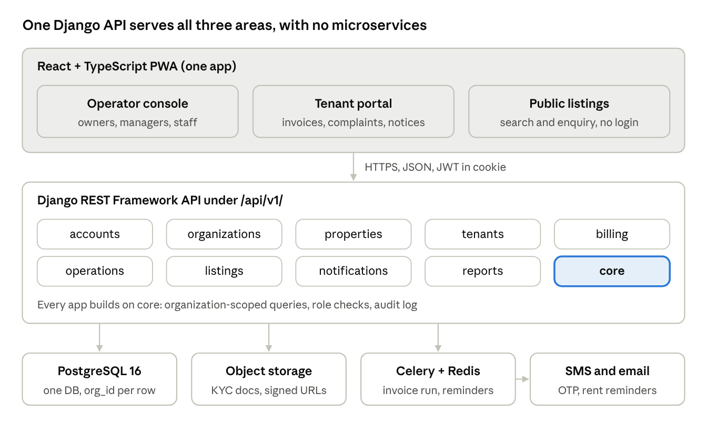
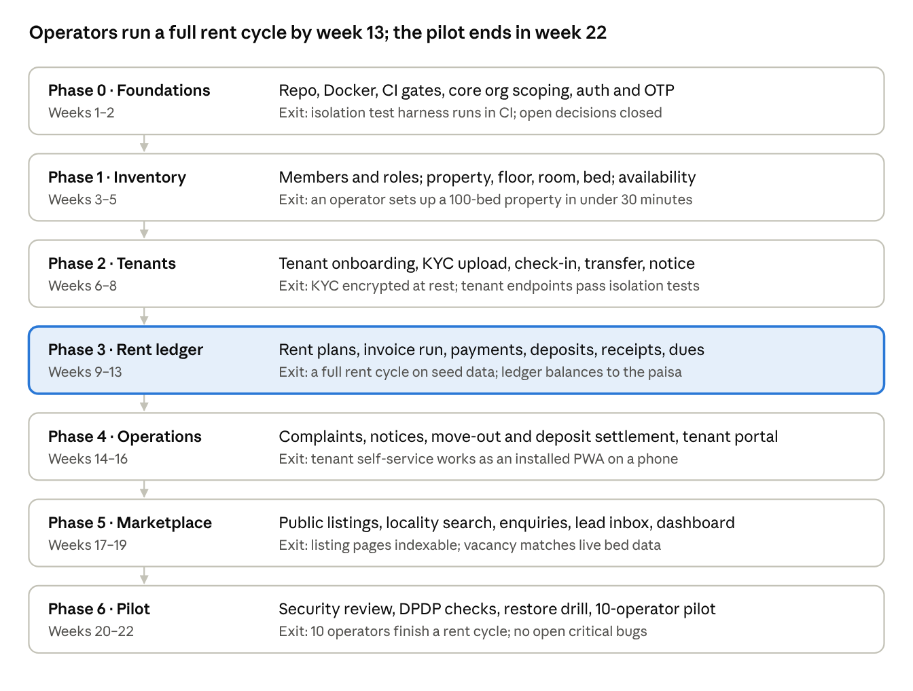

# PG Management SaaS: Development Plan

> Exported on 18 Oct 2026 from the living Claude Doc: https://claude.ai/code/artifact/47ef99cb-f396-4e73-81ab-b94d0b037c83
> The online doc is the source of truth; re-export after changes.

Oct 17, 2026 · @Hasaai

## Overview and MVP scope

The plan builds a multi-tenant SaaS for PG and co-living operators in seven phases (0–6) over about 22 weeks. Public property discovery comes after the operator tools work. Launch is in one Bengaluru locality.

**The MVP must let an operator:**

- Set up their properties, floors, rooms and beds, and see which beds are free.
- Onboard tenants with KYC details, agreements and a security deposit.
- Raise monthly rent invoices, record payments (UPI, cash, bank transfer) and track what is overdue.
- Handle complaints, notices and move-outs, with the deposit settled at move-out.
- See a dashboard of occupancy, collections and dues.
- Publish vacant beds to a public listing page that takes enquiries.

**Out of scope for the MVP:** a native mobile app, food or mess management, an online payment gateway with auto-reconciliation, accounting exports, and more than one city.

**Success criteria for launch:**

- 10 operators in the launch locality use it for a full rent cycle.
- Rent for a 100-bed property is invoiced in under 5 minutes.
- No cross-organization data leak in any automated or manual test.

**Assumptions:** a small team (1–2 full-stack developers), each operator is one organization, tenants log in with their phone number and an OTP, and pricing and billing for the SaaS itself come after launch.

## Missing requirements

The brief names the modules but leaves the rules below unstated. Each one changes the data model or the API, so it needs an answer before the phase that builds it. No repository, CLAUDE.md or `docs/PRD.md` was found on the Desktop, so this plan treats the project as new and these answers are open.

| Area | Missing requirement | Assumption in this plan | Needed by |
| --- | --- | --- | --- |
| Bed inventory | Can a bed be reserved with a token amount before check-in? For how long? | Yes, a `reserved` status that lapses after 7 days | Phase 1 |
| Bed inventory | Is rent set per bed, per room or per sharing type? | Per bed, defaulted from the room's sharing type | Phase 1 |
| Rent ledger | Billing date: one fixed date for everyone, or each tenant's check-in anniversary? | Fixed date per property; the first month is pro-rated by day | Phase 3 |
| Rent ledger | Late fee rule, grace days, and whether part payments are allowed | Configurable flat fee after N grace days; part payments allowed | Phase 3 |
| Rent ledger | Electricity and other charges: metered per room, split, or included? | A manual extra-charge line on the invoice | Phase 3 |
| Rent ledger | Deposit size, refund timeline, allowed deductions | Set per Stay; deductions itemized at checkout | Phase 3 |
| Rent ledger | GST on rent (residential stays are usually exempt) and invoice numbering | No GST; sequential numbers per property | Phase 3 |
| Tenants | Which KYC documents are required? Is police verification in scope? | Aadhaar or another government ID; police verification later | Phase 2 |
| Tenants | Do tenants need app logins at launch, or only operators? | Yes, phone OTP, read-mostly portal | Phase 0 |
| Listings | What does a listing show: exact address or locality only, rent range or exact rent, photos? | Locality and landmark, rent per sharing type, photos; exact address after an enquiry | Phase 5 |
| Listings | Can operators outside the SaaS list properties? Are listings moderated? | No: only paying operators, approved by us before going live | Phase 5 |
| Enquiries | How are leads routed, and what are the follow-up states? | To the property's managers; new, contacted, visit booked, converted, lost | Phase 5 |
| Reporting | Exact reports and the period they cover | Occupancy, collections vs due, overdue list, monthly, with CSV | Phase 5 |
| Platform | Languages (English only, or Kannada and Hindi too) | English only at launch | Phase 0 |
| Platform | Expected scale at launch | Up to 50 operators and 5,000 beds | Phase 6 |

## Users and roles

There are five roles. Each role is checked on the server for every request, always within one organization.

| Role | Who | Can do | Cannot do |
| --- | --- | --- | --- |
| Owner | PG business owner | Everything in their organization, including staff, billing settings and deletion | See other organizations |
| Manager | Property manager | Run assigned properties: tenants, rent, complaints, listings | Manage staff, change organization settings |
| Staff | Warden, caretaker | View tenants and rooms in assigned properties, update complaints | Touch money, KYC documents or deposits |
| Tenant | Resident | See own profile, invoices, receipts, notices; raise complaints; give move-out notice | See other tenants or any operator data |
| Visitor | Public, not logged in | Browse listings, send an enquiry | Anything behind login |

A platform admin role (us) exists only in Django admin, for support, and every access is logged.

## Feature modules

The MVP is built from nine Django apps, one for each business area. Each app owns its own models, serializers, views, permissions and tests.

| Django app | MVP features | Later |
| --- | --- | --- |
| `accounts` | Email + password for operator staff, phone OTP for tenants, JWT sessions, password reset | SSO, 2FA for owners |
| `organizations` | Organization signup, members, roles, property assignment, invitations | SaaS subscription plans and billing |
| `properties` | Property → floor → room → bed, amenities, sharing type, rent per bed, photos | Bulk import from Excel |
| `tenants` | Tenant profile, KYC (ID type, number, document upload), emergency contact, check-in to a bed, room transfer | Police verification workflow |
| `billing` | Rent plans, monthly invoice run, extra charges (electricity, late fee), payments, receipts (PDF), dues ledger, deposits | Payment gateway, auto-reconciliation, GST invoices |
| `operations` | Complaints with status and assignee, notices to tenants, move-out notice and checkout with deposit settlement | Visitor log, attendance, food menu |
| `listings` | Public listing per property, vacancy from live bed data, locality search, enquiry form, lead inbox | Reviews, map search, featured listings |
| `notifications` | In-app notifications, email, SMS for OTP and rent reminders | WhatsApp, push |
| `reports` | Dashboard: occupancy %, collections vs due, overdue tenants, CSV export | Profit and loss, multi-property comparison |

Shared code (organization-scoped base model, permission classes, pagination, audit log) lives in a `core` package, not in an app with business logic.

## System architecture

The system is a modular monolith: one React PWA, one Django API split into apps by business area, PostgreSQL, and one background worker.



Every request passes through `core`, which sets the organization and checks the role before any app code runs.

**Repository layout** (one repository, two separately organized halves)

```text
pg-saas/
  backend/
    config/            settings (base, local, staging, prod), urls, celery
    core/              org-scoped base model and viewset, permissions, audit
    apps/
      accounts/ organizations/ properties/ tenants/ billing/
      operations/ listings/ notifications/ reports/
        models.py serializers.py views.py urls.py
        services.py permissions.py tests/
    pyproject.toml
  frontend/
    src/
      app/             routes, layouts, guards
      features/        operator/, tenant/, public/
      api/             generated types + query hooks
      components/ lib/
    tests/e2e/         Playwright
  docker-compose.yml
  .github/workflows/
  docs/                requirements, decisions (ADRs)
```

Business rules (rent, pro-rating, deposits) live in `services.py`, not in views or serializers, so they can be tested without HTTP.

## Core data model

Every business table has an `organization_id` foreign key, plus `created_at`, `updated_at` and `created_by`. Money is stored as integer paise, never as a float. IDs are UUIDs so they cannot be guessed from the URL.

| Model | Key fields | Relations |
| --- | --- | --- |
| Organization | name, slug, contact phone, GSTIN (optional), status | has many Memberships, Properties |
| User | email or phone, name, is\_active | has many Memberships; optional TenantProfile |
| Membership | role (owner, manager, staff), status | User ↔ Organization; many-to-many with Properties assigned |
| Property | name, address, locality, gender (men, women, co-ed), amenities, is\_listed | belongs to Organization; has many Floors |
| Floor / Room | label, sharing type (1–4), AC flag | Room belongs to Floor; has many Beds |
| Bed | label, monthly rent, status (vacant, reserved, occupied, blocked) | belongs to Room |
| TenantProfile | KYC type, KYC number (encrypted), document file, emergency contact | linked to User and Organization |
| Stay | check-in date, notice date, check-out date, rent, deposit, status | Tenant ↔ Bed; one active Stay per bed |
| Invoice / InvoiceLine | period, due date, amount, status (draft, issued, part paid, paid, void) | belongs to Stay |
| Payment | amount, mode, reference, received\_at, received\_by | applied to one or more Invoices |
| DepositTransaction | type (collected, deducted, refunded), amount, reason | belongs to Stay |
| Complaint | category, priority, status, assignee | raised by Tenant on a Property |
| Notice | title, body, audience (property or all) | belongs to Organization |
| Listing / Enquiry | public slug, photos, description / name, phone, move-in date, status | Listing belongs to Property; Enquiry to Listing |
| AuditLog | actor, action, object, before and after values | belongs to Organization |

Database constraints enforce the main rules: one active Stay per Bed, a unique invoice per Stay per period, and payments that are never negative.

## API design

All endpoints sit under `/api/v1/`. The server works out the organization from the logged-in user's membership, never from a request field. The OpenAPI schema is generated from code, and the frontend's types are generated from that schema.

**Conventions**

- JSON, snake\_case fields, ISO 8601 dates, amounts in paise.
- Cursor pagination with `?cursor=` and `page_size` (default 25, max 100), plus filters such as `?status=` and `?property=`.
- One error format for every failure: `{"error": {"code", "message", "fields"}}`.
- Status codes: 400 validation, 401 not logged in, 403 wrong role, 404 for objects in another organization (so their existence is never revealed), 409 conflicts such as a bed that is already taken.
- Operator users switch organization with an `X-Organization` header. The server checks it against their memberships.
- Money-changing POSTs take an `Idempotency-Key` header so a retry never pays twice.

**Endpoints (MVP)**

| Area | Endpoints |
| --- | --- |
| Auth | `POST auth/login`, `auth/otp/request`, `auth/otp/verify`, `auth/refresh`, `auth/logout`, `GET auth/me` |
| Organization | `organizations/current`, `members/`, `invitations/` |
| Properties | `properties/`, `properties/{id}/floors/`, `rooms/`, `beds/`, `GET beds/availability` |
| Tenants | `tenants/`, `tenants/{id}/documents/`, `stays/`, `POST stays/{id}/transfer`, `stays/{id}/notice`, `stays/{id}/checkout` |
| Billing | `invoices/`, `POST invoices/generate`, `payments/`, `GET receipts/{id}.pdf`, `deposits/`, `GET dues/` |
| Operations | `complaints/`, `notices/` |
| Tenant self-service | `me/stay`, `me/invoices`, `me/complaints`, `me/notices` |
| Public | `public/listings/?locality=`, `public/listings/{slug}`, `POST public/listings/{slug}/enquiries` (rate limited) |
| Leads and reports | `enquiries/`, `reports/dashboard`, `reports/collections.csv` |

## Security and multi-tenancy

All tenants share one database and one schema, and an `organization_id` on every row keeps their data apart. Isolation is enforced in three layers, so a single missed filter does not leak data.

1. **Query layer:** every organization-owned model uses an `OrgScopedManager`. Views inherit from an `OrgScopedViewSet` that filters every queryset by the request's organization and sets it on create. A model that skips this base fails a CI check.
2. **Permission layer:** DRF permission classes check role and property assignment on every action, and object-level checks run on every retrieve, update and delete.
3. **Test layer:** a shared isolation test suite runs against every endpoint. User A from organization 1 tries to list, read, update and delete organization 2's objects, and every attempt must return 404.

PostgreSQL row-level security is held back as a later hardening step. It adds complexity to migrations and tests that the MVP does not need yet.

**Other controls**

- Short-lived JWT access tokens (15 minutes) and rotating refresh tokens in an httpOnly, Secure, SameSite cookie.
- OTP rate limits: 5 requests per phone per hour, 5 tries per code, 5-minute expiry.
- KYC numbers are encrypted at the field level and masked in the UI. KYC documents sit in private object storage behind short-lived signed URLs.
- File uploads: type and size checked (images and PDF, up to 5 MB) and stripped of metadata.
- Secrets come only from environment variables or a secret manager. `.env` files are git-ignored, and secret scanning runs in CI.
- The audit log covers every change to money, KYC data, roles and checkouts.
- **Compliance:** India's DPDP Act 2023 applies to tenant personal data. The MVP needs a consent notice at onboarding, data used only for its stated purpose, deletion on request after the legal retention period, and a named grievance contact. This needs a legal review before launch.

## Frontend and PWA

There is one React + TypeScript app with three areas: the operator console, the tenant portal and the public listing pages. Each area has its own routes and layout. Screens are designed for a 360 px phone first, because wardens and tenants will mostly use phones.

| Concern | Proposed choice | Why |
| --- | --- | --- |
| Build tool | Vite | Fast dev server, standard for React + TS |
| Routing | React Router | Nested layouts per area, route guards by role |
| Server state | TanStack Query | Caching, retries, offline reads |
| API types | openapi-typescript from the DRF schema | Frontend and backend types cannot drift apart |
| Forms | React Hook Form + Zod | Typed validation that mirrors server errors |
| UI | Tailwind CSS + a small headless component set | Small bundle, mobile-first |
| PWA | vite-plugin-pwa (Workbox) | Install prompt, offline shell, cached reads |
| Unit tests | Vitest + Testing Library | Same config as Vite |

Each library is added only in the phase that needs it, with a one-line reason in the PR.

**PWA behaviour:** the app installs to the home screen. Its shell and last-viewed lists (beds, tenants, dues) work offline as read-only. Writes need a connection and show a clear offline state. Offline payment entry is held back until after launch.

**Public listing pages** need to be found on search engines. They are pre-rendered at build time or served as server-rendered HTML from Django, with proper titles, meta tags and a sitemap. This choice is made in Phase 5.

## Testing and quality gates

A feature is done only when its success, failure and permission tests pass in CI. That includes the test that another organization cannot reach the data.

| Layer | Tool | What it covers |
| --- | --- | --- |
| Backend unit | pytest, pytest-django, factory\_boy | Models, services, rent and deposit calculations, invoice generation |
| Backend API | DRF APIClient through pytest | Every endpoint: success, validation failure, wrong role, other organization |
| Frontend unit | Vitest + Testing Library | Forms, guards, money formatting |
| End to end | Playwright | Top journeys on desktop and phone sizes: sign up, add a property, onboard a tenant, run rent, take a payment, check out, public enquiry |

**Gates on every pull request**

- Backend: `ruff` (lint and format), `mypy` with django-stubs, `pytest` with at least 85% coverage on `billing` and `core` and 75% overall, and `makemigrations --check`.
- Frontend: ESLint, Prettier check, `tsc --noEmit`, Vitest.
- Playwright smoke suite on every pull request; the full suite runs nightly and before each release.
- Dependency and secret scanning.

Failing checks block the merge. The summary for each feature lists the commands run and their real results.

## Environments, CI/CD and operations

The MVP runs as one Django service, one static frontend, PostgreSQL and a background worker. There are no microservices.

| Environment | Purpose | Data |
| --- | --- | --- |
| Local | Docker Compose: Django, PostgreSQL 16, Redis, Vite dev server, Mailpit | Seeded fake data |
| Staging | Auto-deploys from `main` | Fake data only |
| Production | Deploys from a release tag after a manual approval | Real data, daily backups and point-in-time restore |

- **Background jobs:** Celery + Redis for the monthly invoice run, rent reminders, PDF receipts and SMS. Celery Beat schedules them. This is the one extra service, and it is needed because these jobs cannot run inside a web request.
- **CI:** GitHub Actions runs the gates above on every PR. Docker images are built once and promoted from staging to production.
- **Hosting:** a managed PostgreSQL service and a container host in an Indian region (Mumbai or Hyderabad) keep data in India and latency low. The vendor is chosen in Phase 0.
- **Migrations** run as a separate step before new code starts. They are backward-compatible: add the column first, then switch code over, then remove the old one.
- **Observability:** Sentry for errors, structured JSON logs, uptime checks, and a health endpoint at `/api/v1/health`.
- **Backups:** daily, kept for 30 days, with a restore drill once a month before launch.

## Phased roadmap and backlog

There are seven phases over about 22 weeks. Each phase ends with a gate that has to pass before the next one starts. The rent ledger is the largest and riskiest phase, so it gets five weeks.



The weeks assume one to two developers and move as the team size changes.

**Backlog by phase** (each item is one pull request with its tests)

| Phase | Backlog items |
| --- | --- |
| 0 Foundations | Repo layout and Docker Compose · CI with lint, type and test gates · `core` org-scoped base model, viewset and permissions · isolation test harness · email login and phone OTP with JWT · frontend shell, routing, generated API client |
| 1 Inventory | Organization signup and invitations · roles and property assignment · property CRUD with amenities · floors, rooms, beds · bed status rules · availability view · photo upload |
| 2 Tenants | Tenant profile and KYC with encrypted fields · document upload to private storage · check-in creates a Stay and fills the bed · room transfer · move-out notice · audit log entries |
| 3 Rent ledger | Rent plan per Stay · pro-rating rule · monthly invoice job (Celery) · extra charges and late fees · record payment with idempotency · part payments · deposit ledger · PDF receipts · dues list · SMS and email reminders |
| 4 Operations | Complaints with assignee and status · notices · checkout with deposit settlement · tenant portal (stay, invoices, complaints, notices) · PWA install and offline read-only cache |
| 5 Marketplace | Listing editor · public listing pages with SEO · locality search and filters (rent, gender, sharing, amenities) · enquiry form with rate limit and captcha · lead inbox · dashboard and CSV export |
| 6 Pilot | Security and permission review · DPDP consent and retention · load test at 50 operators and 5,000 beds · backup restore drill · onboarding of pilot operators · bug fixing |

## Risks and open decisions

| Risk | Impact | Mitigation |
| --- | --- | --- |
| Data leaks between organizations | Loss of trust, legal exposure | Three-layer isolation and an isolation test on every endpoint |
| Operators keep using Excel or WhatsApp | Low adoption | Excel import, setup under 30 minutes, onboard the first 10 operators in person |
| Rent and deposit edge cases (mid-month joins, pro-rating, partial payments) | Wrong dues, disputes | Write the rules down in Phase 0, cover them with table-driven tests, keep a ledger rather than editable balances |
| Scope creep (food, attendance, gateway) | Missed launch | Hold the MVP scope; anything new goes on the Later list |
| KYC data handling under the DPDP Act | Regulatory risk | Encryption, consent, retention rules, legal review before launch |
| SMS cost and delivery for OTP | Login failures | A DLT-registered SMS provider, with email login as a fallback |

**Decisions needed before Phase 1**

- [ ] Pro-rating rule for mid-month check-ins (daily rate, or a fixed billing date per tenant)
- [ ] Hosting vendor and SMS provider
- [ ] Whether operators record UPI payments by hand at launch (the assumption here) or a gateway is added
- [ ] Name of the launch locality, which sets the seed data and listing SEO
- [ ] How public listing pages are rendered: pre-rendered by the frontend, or served as HTML from Django
